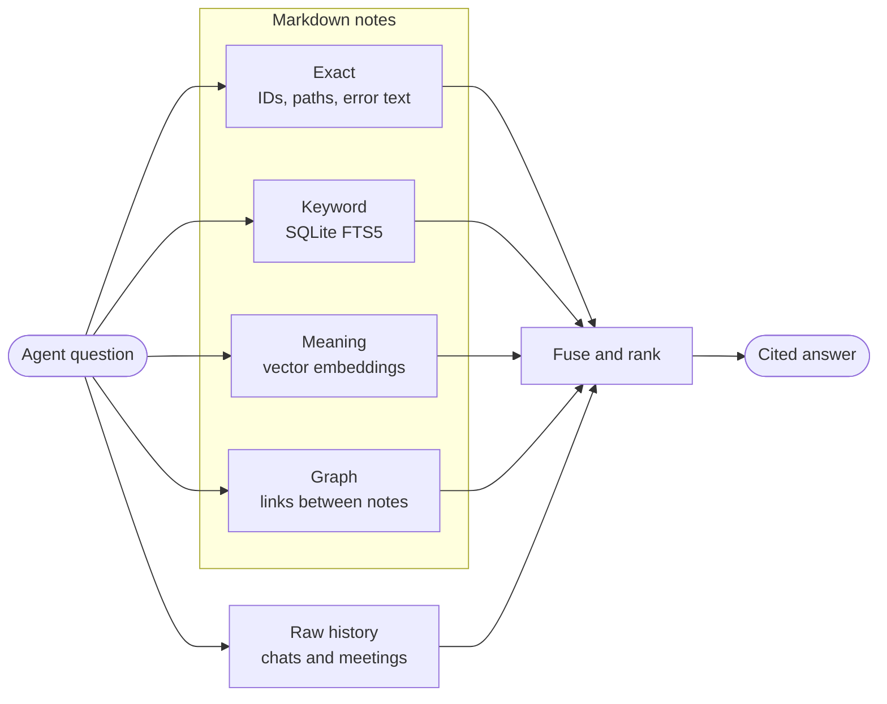
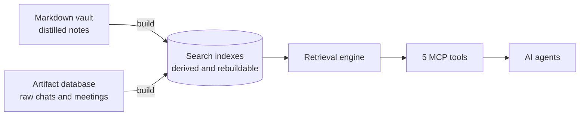
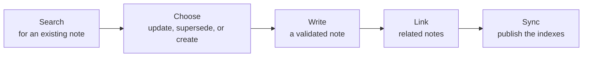

# AI Memory MCP

**Long-term memory for AI agents. Searchable, cited, and stored as plain Markdown.**

AI Memory MCP is a local server that gives AI agents a durable memory.
Agents save what they learn as Markdown notes.
Later, four search methods work together to find the right note again.
Every answer cites its source.

[Why](#why-ai-memory-mcp) · [How it works](#how-it-works) · [Organization](#a-vault-that-organizes-itself) · [Quick start](#quick-start) · [Go deeper](#go-deeper)

## Why AI Memory MCP

- **Answers with proof.** Each result carries a source path or an `artifact://` citation. The skill tells agents to read the source before they state a fact.
- **Search that finds the note.** Exact, keyword, meaning, and graph search run together. One ranking picks the best result.
- **Local and private.** The embedding model runs on your machine. Search needs no external API. Your notes are plain Markdown files that you own.
- **Safe by design.** Markdown and one SQLite database hold the truth. Search indexes rebuild from them. A failed refresh keeps the last good index. Agents retire old facts with `superseded` status instead of deletion.
- **One memory for every agent.** Setup configures Codex, Claude Code, Claude Desktop, GitHub Copilot CLI, OpenCode, and Visual Studio Code. The server runs on Windows, macOS, and Linux.
- **Chats and meetings included.** The artifact database keeps raw conversations and transcripts. Agents distill them into notes that cite the raw source. Incremental indexing keeps large histories fast.

## How it works

Each search method is strong where the others are weak.
AI Memory MCP runs them together and merges the results.

### Five memory systems, one ranked answer



| Method | Finds | Built with |
|---|---|---|
| Exact | Identifiers, paths, filenames, and error text | SQLite FTS5 with exact-match priority |
| Keyword | Notes that share the words of the query | SQLite FTS5 |
| Meaning | Paraphrases and related ideas | Local Model2Vec vector embeddings, with a hashed fallback |
| Graph | Notes that connect to the best matches | Wikilinks, `related` fields, and shared scopes |
| Raw history | Messages, meetings, and transcripts | A full-text index and source-segment vectors |

The first four methods search your notes.
The fifth method searches the raw conversations and meetings.

### How results are ranked

Reciprocal rank fusion (RRF) merges the ranked list from each method.
Small, bounded adjustments then set the final order.

| Step | Effect |
|---|---|
| Scope filters | Run first, so notes outside the requested scope never compete. |
| Fusion | Each method keeps its own rank list, so no method loses weight through list order. |
| Exact bonuses | An identifier, an exact phrase, or a title match raises a result. |
| Agreement | A result that both keyword and meaning search found gets a bonus. |
| Freshness | A recent `updated` date breaks near-ties. An overdue `review_after` date lowers a note. |

Raw history never receives an age penalty.

### Where the truth lives



- **The Markdown vault** holds distilled notes. The primary vault is the only write target. Extra vaults are retrieval-only.
- **The artifact database** holds raw conversations and transcripts. Only the `ai-memory-artifact` command writes to it.
- **The search indexes** are derived data. `memory_sync` builds all of them as one generation, and each recall reads one generation.

If any layer fails validation, recall keeps the previous generation.
Read the [architecture guide](docs/architecture.md) for the complete design.

## A vault that organizes itself

Agents file each memory, and the server checks that every note follows one structure.
The agent decides where a note goes.
The server rejects a write that breaks the rules.



| Step | What happens |
|---|---|
| Search | The agent looks for a precise existing note before it writes. This prevents duplicates. |
| Choose | The agent updates a note, supersedes an old fact, or creates a note. A conflict gets `needs-review`. |
| Write | `memory_upsert` checks the schema, the path, and the unique `memory_id`. It then writes the file atomically. |
| Link | `related` fields and body wikilinks become graph edges. Code blocks and comments make no edge. |
| Sync | `memory_sync` publishes new indexes. The next recall can find the note. |

### What the vault looks like

```text
AI-Memory/
├── Home.md                  starter dashboard
├── Notes/                   one note for each independent topic
├── Collections/
│   └── Projects/
│       ├── Projects.base    Obsidian table view
│       └── Records/         typed notes
├── Views/                   Action Dashboard, Review Queue, Memory Health
└── Archive/                 inactive notes that stay recoverable
```

A folder appears only when a note needs it.
The folder path never defines the meaning of a note.
The `record_type`, `domain`, and scope fields define the meaning.

<details>
<summary>See a note</summary>

```markdown
---
schema_version: 2
memory_id: mem-deployment-process
title: Deployment process
type: memory
record_type: note
domain: work
status: active
created: 2026-10-14
updated: 2026-10-14
review_after: 2027-04-14
aliases:
  - release steps
related:
  - "[[Production configuration]]"
provenance:
  - source: manual
    reference: task:example-1
    verified: 2026-10-14
---
# Deployment process

The service deploys from the `main` branch through the release pipeline. A deploy needs one reviewer approval.

## Steps

1. Merge the approved pull request.
2. Wait for the pipeline to publish the build.
3. Check the health endpoint at `/healthz`.

See [[Production configuration]] for the settings that the pipeline applies.
```

</details>

The vault stays clean for these reasons:

- Each note holds one topic, and each note starts with a summary that can stand alone.
- The title, the file name, and the H1 heading match.
- Obsidian Bases views list open actions, notes that need review, and schema health.
- An agent adds missing aliases, exact strings, and links to a note that was hard to find.
- Raw meetings and chats become notes with `artifact://` citations. Manual text outside the managed region stays unchanged.
- The `ai-memory-migrate` command moves a legacy vault to this layout. It makes snapshots and supports rollback.

## Quick start

Install Git and Python 3.11 or later.
On Windows, the `.ps1` scripts also need PowerShell 5.1 or later.

1. Clone the repository.

```bash
git clone <repository-url> ai-memory-mcp && cd ai-memory-mcp
```

2. Run the setup command for your platform.

macOS and Linux:

```bash
./scripts/setup.sh --memory-root ~/AI-Memory --install-clients
```

Windows (PowerShell):

```powershell
.\scripts\setup.ps1 -MemoryRoot 'C:\path\to\AI-Memory' -InstallClients
```

3. Restart each configured client.
4. Ask the agent to call `memory_status`.
5. Check that every layer is healthy.

Setup creates the `.venv` environment and installs the project with its local embedding model.
It writes the `.env` file, creates the internal data under `AI_MEMORY_WORK_DIR/.ai-memory/`, and publishes the first index generation.
The `--install-clients` option registers the server and the skill with each supported client.

To add the starter dashboard, run this optional command.

macOS and Linux:

```bash
./.venv/bin/ai-memory-vault --root ~/AI-Memory
```

Windows (PowerShell):

```powershell
.\.venv\Scripts\ai-memory-vault.exe --root 'C:\path\to\AI-Memory'
```

After setup, agents search and save memory on their own.
You can also ask directly:

- "Remember that the staging database uses port 5433."
- "What did we decide about the retry policy?"

For more detail, read the [installation guide](docs/installation.md) and the [AI agent setup guide](docs/agent-new-system-setup.md).

## Go deeper

### MCP tools

| Tool | Function |
|---|---|
| `memory_recall` | Returns cited Markdown and artifact evidence. |
| `memory_artifact_read` | Returns ordered raw context for one `artifact://` citation. |
| `memory_upsert` | Creates or updates one validated canonical record. |
| `memory_sync` | Publishes one coordinated generation after a canonical change. |
| `memory_status` | Reports strict health for every required layer. |

### Command-line tools

| Command | Function |
|---|---|
| `ai-memory-mcp` | Runs the MCP server. |
| `ai-memory-sync` | Publishes one generation: Markdown index, artifact index, and note graph. |
| `ai-memory-artifact` | Manages the canonical artifact database. It supplies `ingest`, `search`, `read`, `pending`, `backup`, `check`, and `restore`. |
| `ai-memory-vault` | Creates the starter vault layout. |
| `ai-memory-collection` | Creates a typed collection with an Obsidian Base. |
| `ai-memory-migrate` | Moves a legacy vault to the current layout with snapshots and rollback. |
| `ai-memory-benchmark` | Runs the frozen retrieval benchmark. |

### Quality gates

The frozen benchmark contract requires these results:

- A pass rate of `1.0`, with recall at 5 of `1.0`.
- A no-answer accuracy of `1.0`.
- No scope leakage and no citation failures.
- An approximate-search candidate recall at 10 of at least `0.95`.

The benchmarks use synthetic data only.
Read the [retrieval reliability validation](docs/retrieval-reliability-validation.md) for the measured results and the capacity evidence.

### Documentation

The [documentation index](docs/README.md) links to every guide.

- [Installation](docs/installation.md) and [Configuration](docs/configuration.md)
- [Operations](docs/operations.md), including the upgrade from the earlier Graphify-based release
- [Architecture](docs/architecture.md) and [Artifact storage](docs/artifact-storage.md)
- [Markdown intake contract](docs/intake-contract.md)
- [Development](docs/development.md) and [Validation](docs/validation-report.md)
- [Skill discovery stubs](docs/skill-discovery-stubs.md)

The independent [Graphify Codebase](graphify-codebase/README.md) skill indexes software repositories.
It never supplies data to AI Memory retrieval.

### Contributing

This is a public repository.
It contains only neutral examples and synthetic benchmark fixtures.
The user memory directory, generated indexes, logs, and the `.env` file stay outside Git.
Read [AGENTS.md](AGENTS.md) and the [writing standard](docs/writing-standard.md) before you change this repository.
